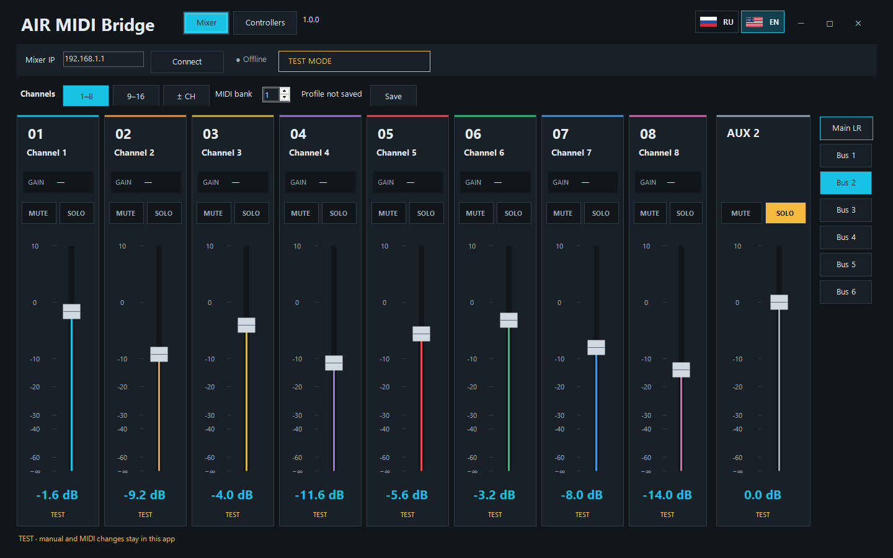
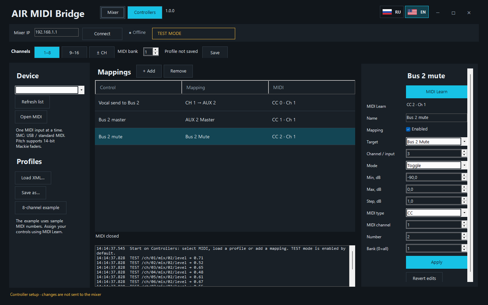

# AIR MIDI Bridge

[Русский](#ru) · [English](#en)





<a id="ru"></a>

## Русский

AIR MIDI Bridge позволяет управлять цифровым пультом Midas M AIR или Behringer X AIR с MIDI-контроллера. Например, можно назначить ползунок на громкость вокала, а соседнюю кнопку — на отключение того же канала. Контроллер подключается к компьютеру с Windows, а компьютер отправляет команды пульту по сети через OSC.

С MIDI-контроллера можно менять посыл отдельного канала в AUX 1–6 и общую громкость каждой шины. Например, CH → AUX 2 регулирует уровень выбранного канала во втором мониторе, а AUX 2 Master — громкость всего монитора. На экране выберите Bus 1–6 справа для управления монитором. На мастере шины доступны Mute и Solo. Обе кнопки можно назначить через MIDI Learn.

### Первый фейдер

1. Подключите MIDI-контроллер к компьютеру и убедитесь, что компьютер и пульт находятся в одной сети. Для сборки из исходников откройте Windows PowerShell в папке проекта и выполните `.\build.ps1`. Нужен .NET Framework 4.x с компилятором C#. Запустите **MR18-MIDI.exe**. Имя файла осталось от первой версии для MR18.
2. Откройте **Контроллеры**, выберите и откройте MIDI-вход. Введите IPv4-адрес пульта вручную и подключитесь. Если у вас уже есть XML-профиль для MR18, его можно загрузить здесь.
3. Нажмите **+ Добавить**, выберите фейдер канала 1 и нажмите **Обучить MIDI**. Передвиньте нужный ползунок. В тестовом режиме можно проверить назначение, пока громкость на пульте остаётся прежней.
4. Перейдите на вкладку **Микшер** и включите управление. Если выбран режим Pickup (подхват), доведите ползунок до текущего положения фейдера на пульте. С этой точки они будут двигаться вместе.

Сохраните назначения в XML-профиль, чтобы использовать их на следующей репетиции. Таким же способом можно назначить кнопки Mute и Solo, мастер-фейдер Main LR и относительные энкодеры. Банки позволяют использовать один набор ручек для нескольких групп назначений. Язык интерфейса переключается флагами России и США, выбор сохраняется между запусками.

### С какими пультами работает версия 0.5 beta

| Пульт | Фейдеры входных каналов | Входы с управлением гейном |
|---|---:|---:|
| Midas MR18 / MR18V2 | 16 | 1–16 |
| Midas MR12 / MR12W | 12 | 1–4 |
| Behringer XR18 / X18 | 16 | 1–16 |
| Behringer XR16 | 16 | 1–8 |
| Behringer XR12 | 12 | 1–4 |

Предыдущую версию использовали на реальном MR18. Пользователь подтвердил работу версии 0.5 beta на своём Behringer XR18. Остальные модели этой версии пока проверены программно. **Gain управляет предусилителем физического входа.** Например, на XR16 можно менять громкость канала 12, а гейн доступен только для входов 1–8.

При подключении приложение запрашивает модель пульта через `/xinfo` по UDP на порту 10024. Для включения управления модель должна быть распознана, а все активные назначения должны ей подходить. X32, M32, WING и HD96 используют другие протоколы и пока не поддерживаются. В этой версии также нет управления возвратами и DCA, индикаторов уровня, обратной связи для подсветки кнопок и моторизованных фейдеров.

### Для разработчиков

После сборки запустите проверки из папки проекта. Первая команда проверяет протокол через локальный UDP, вторая открывает отдельное тестовое окно. Для обеих проверок пульт не нужен. При отправке изменений на GitHub автоматически запускаются сборка для Windows и тесты протокола.

```powershell
.\MR18-MIDI-Tests.exe --self-test
.\MR18-MIDI-Tests.exe --ui-test
```

Если проверите программу на своём пульте, укажите модель, версию прошивки, контроллер и какие назначения сработали. [Как сообщить о результате](CONTRIBUTING.md)

<a id="en"></a>

## English

AIR MIDI Bridge lets you control a Midas M AIR or Behringer X AIR mixer from a MIDI controller. You could map a slider to the vocal channel and use the button beside it to mute the singer’s mic between songs. The controller connects to your Windows PC, which sends OSC commands to the mixer over the network.

You can control AUX 1–6 from MIDI, including individual channel sends and each bus master level. For example, CH → AUX 2 adjusts one channel in the second monitor mix, while AUX 2 Master adjusts the whole mix. On screen, select Bus 1–6 on the right to mix monitors. Each bus master has Mute and Solo, both assignable via MIDI Learn.

### Map your first fader

1. Plug your MIDI controller into your PC and make sure the PC and mixer are on the same network. To build from source, open Windows PowerShell in the project folder and run `.\build.ps1`. You’ll need .NET Framework 4.x with its C# compiler. Launch **MR18-MIDI.exe**. The filename dates back to the original MR18 version.
2. Open **Controllers**, select your MIDI input and open it. Enter the mixer’s IPv4 address and connect. If you already have an MR18 XML profile, you can load it here.
3. Click **+ Add**, choose the channel 1 fader and click **MIDI Learn**. Move the slider you want to use. Test mode lets you check the mapping while the mixer stays at its current level.
4. Switch to **Mixer** and enable live control. If you selected Pickup mode, move the slider until it reaches the mixer’s current fader position. From that point on, the two move together.

Save your mappings to an XML profile for the next rehearsal. You can also assign mute and solo buttons, the Main LR fader and relative encoders. Banks let you reuse the same controls for several sets of mappings. Use the Russian and US flags to switch the interface language. The app remembers your choice.

### Mixer compatibility in 0.5 beta

| Mixer | Input channel faders | Inputs with preamp gain control |
|---|---:|---:|
| Midas MR18 / MR18V2 | 16 | 1–16 |
| Midas MR12 / MR12W | 12 | 1–4 |
| Behringer XR18 / X18 | 16 | 1–16 |
| Behringer XR16 | 16 | 1–8 |
| Behringer XR12 | 12 | 1–4 |

An earlier version was used on a physical MR18. A user confirmed version 0.5 beta works on their Behringer XR18. The other models have software-test coverage for this version. **Gain controls the physical input preamp.** On an XR16, for example, you can move the channel 12 fader, while preamp gain is available only on inputs 1–8.

When you connect, the app checks the mixer model using `/xinfo` over UDP port 10024. Live control requires a recognized model and valid assignments for every enabled mapping. X32, M32, WING and HD96 use different protocols and are currently unsupported. This version also lacks returns, DCA control, level meters, button LED feedback and motorized fader feedback.

### For developers

After building, run these checks from the project folder. The first tests the protocol over localhost UDP. The second opens a separate test window. Both run without a mixer. GitHub Actions builds the app and runs the protocol tests on Windows.

```powershell
.\MR18-MIDI-Tests.exe --self-test
.\MR18-MIDI-Tests.exe --ui-test
```

If you try the app on your mixer, tell us the model, firmware version, controller and which mappings worked. [How to report your results](CONTRIBUTING.md)

## Ссылки / Links

- [Описание протокола X AIR / Manufacturer’s X AIR protocol guide](https://cdn.mediavalet.com/aunsw/musictribe/hmivS7F05kKSJlWDYPGLpA/agTKkSIWS0y1bJl97YZEjg/Original/X%20AIR%20Remote%20Control%20Protocol.pdf)
- [Пример реализации OSC / OSC reference implementation](https://github.com/onyx-and-iris/xair-api-python)
- [Лицензия MIT / MIT license](LICENSE)

Независимый проект сообщества, без официальной связи с Music Tribe, Midas или Behringer.

An independent community project unaffiliated with Music Tribe, Midas or Behringer.
